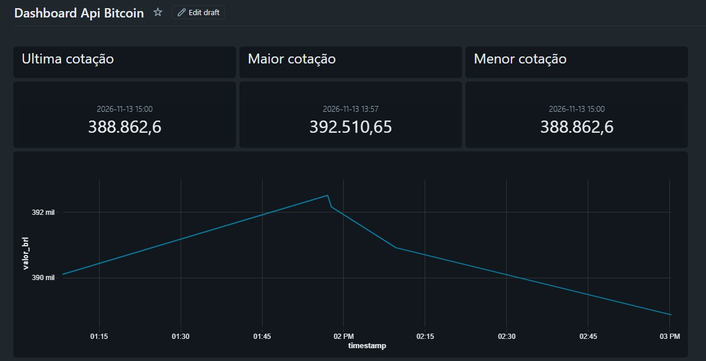

# ₿ Pipeline de Dados: Preço do Bitcoin em BRL

Pipeline de engenharia de dados desenvolvido com **Databricks, PySpark e Delta Lake**, responsável por coletar o preço do Bitcoin em dólares (USD), obter a cotação do dólar em reais (BRL), realizar a conversão e armazenar os dados historicamente no Unity Catalog.

O projeto possui execução automatizada a cada hora e um dashboard para acompanhamento da cotação e evolução histórica do Bitcoin em reais.

## 📊 Dashboard



## 🏗️ Arquitetura

O pipeline integra duas APIs públicas, realiza o processamento dos dados utilizando PySpark e armazena os resultados em uma tabela Delta, disponibilizando as informações para consulta no Databricks SQL e visualização no dashboard.


## 🔄 Fluxo do Pipeline

**1. Extração (Extract)**

- Consulta o preço spot do Bitcoin em dólares (USD) por meio da API da Coinbase.
- Consulta a cotação do dólar em relação ao real (USD/BRL) utilizando a API da CurrencyFreaks.

**2. Transformação (Transform)**

- Processa os dados utilizando PySpark.
- Converte o preço do Bitcoin de USD para BRL.
- Registra a taxa de conversão utilizada.
- Adiciona o timestamp correspondente ao momento da coleta.

**3. Carga (Load)**

- Cria o catálogo e o schema caso ainda não existam.
- Cria e alimenta uma tabela no formato Delta Lake.
- Utiliza o modo `append` para preservar o histórico das coletas.

**4. Visualização**

O dashboard consulta os dados armazenados e apresenta:

- Última cotação do Bitcoin em BRL.
- Maior preço registrado.
- Menor preço registrado.
- Evolução histórica do preço.

**5. Orquestração**

Um Databricks Job executa automaticamente o notebook a cada hora, mantendo os dados atualizados sem necessidade de intervenção manual.

## 🛠️ Tecnologias e Ferramentas

| Tecnologia | Aplicação no projeto |
|---|---|
| Python | Linguagem utilizada no desenvolvimento |
| PySpark | Processamento e transformação dos dados |
| Databricks | Plataforma de desenvolvimento e execução |
| Delta Lake | Armazenamento transacional dos dados |
| Unity Catalog | Governança e organização dos dados |
| Databricks Jobs | Orquestração e agendamento |
| Databricks SQL | Consultas utilizadas no dashboard |
| Databricks Dashboards | Visualização e análise dos dados |
| Requests | Consumo das APIs REST |
| Git / GitHub | Versionamento e gerenciamento do código |

## 💾 Armazenamento com Delta Lake

Os dados são armazenados no formato Delta Lake, que utiliza arquivos Parquet como base de armazenamento e adiciona uma camada de controle transacional.

Principais benefícios utilizados no projeto:

- **Armazenamento colunar:** eficiência na leitura e compressão dos dados por meio do formato Parquet.
- **Transações ACID:** maior confiabilidade nas operações de escrita e leitura.
- **Schema Evolution:** possibilidade de evolução da estrutura dos dados.
- **Time Travel:** consulta ao histórico de versões da tabela.

## 🗄️ Estrutura dos Dados

**Tabela:** `pipeline_api_bitcoin.bitcoin_data.bitcoin_data`

| Coluna | Tipo | Descrição |
|---|---|---|
| `valor_usd` | DOUBLE | Preço do Bitcoin em dólares |
| `valor_brl` | DOUBLE | Preço do Bitcoin convertido para reais |
| `criptomoeda` | STRING | Símbolo da criptomoeda (BTC) |
| `moeda_original` | STRING | Moeda original da cotação (USD) |
| `taxa_conversao_usd_brl` | DOUBLE | Cotação USD/BRL utilizada na conversão |
| `timestamp` | TIMESTAMP | Data e hora da coleta |

O histórico é preservado por meio de inserções no modo `append`, permitindo análises temporais e acompanhamento da evolução dos preços.

## ⏰ Agendamento e Orquestração

A execução é gerenciada pelo **Databricks Jobs**, com agendamento automático a cada hora.

| Configuração | Valor |
|---|---|
| Frequência | A cada 1 hora |
| Expressão cron (Quartz) | `0 0 * * * ?` |
| Fuso horário | `America/Sao_Paulo` |
| Tarefa | Execução do notebook PySpark |

## 🔐 Gerenciamento de Credenciais

A chave de acesso da API CurrencyFreaks é armazenada utilizando o recurso **Databricks Secrets**, evitando a exposição de credenciais diretamente no código-fonte ou nas configurações do Job.

No notebook, a credencial é recuperada por meio de:

```python
api_key = dbutils.secrets.get(
    scope="bitcoin_scope",
    key="api_key"
)
```

As credenciais não devem ser publicadas no GitHub, incluídas diretamente no código ou exibidas nos logs de execução.

## 🚀 Como Reproduzir o Projeto

1. Crie uma conta no [Databricks Free Edition](https://www.databricks.com/try-databricks).
2. Crie uma conta na [CurrencyFreaks](https://currencyfreaks.com/) e gere uma chave de API.
3. Importe este repositório para o workspace utilizando Git Folders.
4. Crie um Secret Scope no Databricks e armazene a chave da CurrencyFreaks com o nome `api_key`.
5. Configure o notebook para recuperar a credencial utilizando `dbutils.secrets.get()`.
6. Execute o notebook para realizar a primeira coleta e criação da tabela Delta.
7. Crie um Databricks Job apontando para o notebook.
8. Configure o agendamento para execução a cada hora, utilizando o fuso `America/Sao_Paulo`.
9. Crie o dashboard utilizando as consultas SQL disponíveis na pasta `sql/` ou importe o arquivo `dashboard.lvdash.json`.

## 📁 Estrutura do Repositório

```text
.
├── notebook/
│   └── pipeline_bitcoin.py
├── sql/
│   └── preco-minimo.sql
│   └── preco-maximo.sql
│   └── ultimo-preço.sql
│   └── dados-bitcoin.sql
  
├── docs/
│   └── images/
│       └── dashboard-bitcoin.jpg
├── dashboard.lvdash.json
└── README.md
```


## 🎯 Objetivo do Projeto

Este projeto foi desenvolvido com o objetivo de aplicar conceitos de Engenharia de Dados na construção de um pipeline automatizado, envolvendo integração com APIs REST, processamento de dados, armazenamento em formato Delta Lake, organização utilizando Unity Catalog e visualização de indicadores.

A solução demonstra a implementação de um fluxo de ingestão e transformação de dados com execução recorrente, preservação histórica e disponibilização das informações para análise.

